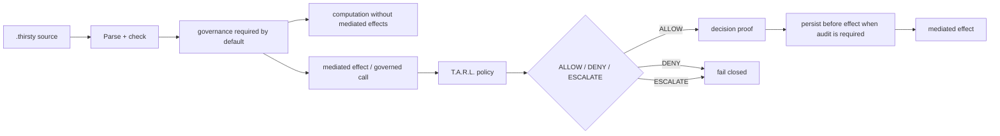
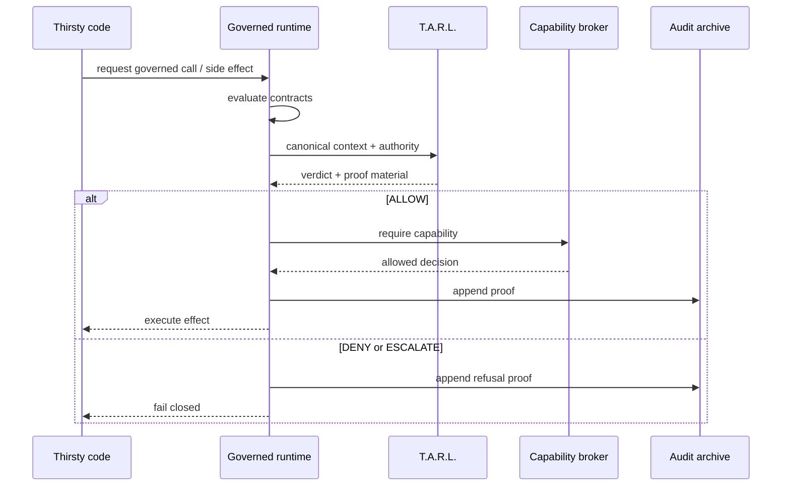
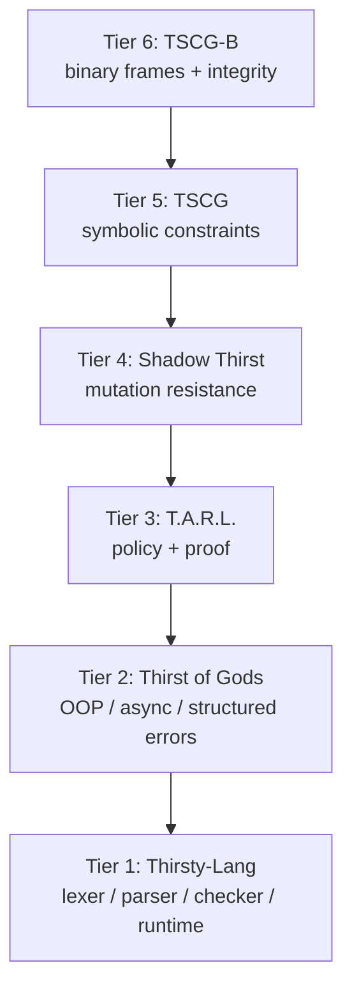

<div align="center">

# 💧 Thirsty-Lang 💧

### *A governance-first programming language family*

Current development: [priority corrections and General Purpose Language plan](docs/DEVELOPMENT_PLAN.md).
Robotics and swarm implementation are deferred while the language foundation
and its verification take priority. The plan identifies implemented work,
compatibility changes, and remaining milestones.

**Version 0.9.1** requires governance by default. Pure calculations can run
immediately. Programs that print, read files, or import modules need an allowing
TARL policy and the required host authority. The reference interpreter and the
installed Node host also support a one-use signed stdout shield.
[Upgrade notes](https://github.com/IAmSoThirsty/Thirsty-lang/blob/pypi-v0.9.1/CHANGELOG.md#091---2026-11-18) · [Shield example](https://github.com/IAmSoThirsty/Thirsty-lang/blob/pypi-v0.9.1/docs/DEFENSIVE_COMPARTMENTS.md#the-first-program)

```text
  source  →  verdict  →  proof  →  audit  →  governed effect

  no policy  ·  no authority  ·  no silent downgrade
  DENY is the default  ·  governance IS the runtime

  ~ ~ ~  Code that has to justify itself before it acts.  ~ ~ ~
```

[](https://pypi.org/project/thirsty-lang/)
[](https://pypi.org/project/thirsty-lang/)
[](LICENSE)
[](https://github.com/IAmSoThirsty/Thirsty-lang/actions/workflows/smoke.yml)
[](https://github.com/IAmSoThirsty/Thirsty-lang/actions/workflows/release.yml)
[](https://github.com/IAmSoThirsty/Thirsty-lang/actions/workflows/docker.yml)
[](https://github.com/IAmSoThirsty/Thirsty-lang/stargazers)
[](https://github.com/IAmSoThirsty/Thirsty-lang/issues)

</div>

---

## What Is Thirsty-Lang?

Thirsty-Lang is a general-purpose language under development whose reference
runtime makes **governance part of execution**. Pure computation works without
a policy. Mediated effects, including imports, input/output, file access, and
process execution, require an allowing policy decision by default. Source code
cannot disable those checks by declaring a `core`, `strict`, or `pure` header.

The runtime records policy decisions and carries caller and defining-function
restrictions through language calls, imports, callbacks, and cascades.
Authenticated authority and Ed25519 proof signing are additional requirements
when hardened execution is selected; a bare authority tag is not authenticated.
Deployments that require durable audit persistence must attach a
`TarlAuditArchive` and enable `set_require_audit(True)`; hardened mode alone
does not provision an archive.

These mechanisms expose inspectable authorization evidence. They do not prove
arbitrary programs correct, provide an OS sandbox, or establish Python parity.
The development plan keeps those limits and remaining language work explicit.

The 0.9.1 reference interpreter includes finite cooperative execution limits, explicit
interpreter/import ownership, cancellation, and idle scheduler teardown. It also
repairs lexical scope in governed functions and methods. See
[execution control](docs/EXECUTION_CONTROL.md) for the supported contract and
the remaining allocation, blocking-adapter, and process-isolation work.

At mediated execution boundaries:

| Principle | Consequence |
|---|---|
| 🌊 No policy for a gated effect | **DENY** |
| 🔐 Required authenticated authority is absent | **DENY** |
| 🧾 No proof | No governed-execution claim |
| ⚡ No verdict | No governed side effect |
| ⛓️ Required audit write fails | **DENY** when an archive is attached and audit is required |
| 🧱 Governance loss | Must be explicitly confessed — never silently dropped |

---

## Install

```bash
pip install thirsty-lang
```

To install this version:

```bash
python -m pip install thirsty-lang==0.9.1
```

From source:

```bash
git clone --branch pypi-v0.9.1 https://github.com/IAmSoThirsty/Thirsty-lang.git
cd Thirsty-lang
pip install -e .
```

## Canonical Manual

Read the [0.9.1 manual online](https://github.com/IAmSoThirsty/Thirsty-lang/blob/pypi-v0.9.1/docs/THIRSTY_LANG_UTF_101.md) or [download the 0.9.1 PDF](https://github.com/IAmSoThirsty/Thirsty-lang/releases/download/pypi-v0.9.1/Thirsty-Lang-UTF-101.pdf). The wheel installs the same PDF. To print its local path from the environment where you installed the package:

```bash
python -c "import sys; from pathlib import Path; print(Path(sys.prefix) / 'share/doc/thirsty-lang/Thirsty-Lang-UTF-101.pdf')"
```

---

## Quick Start

```thirsty
module hello: governed

glass greet(name) {
    return "hello, " + name + "!"
}

drink message = greet("governed world")
message
```

```bash
thirsty run hello.thirsty
```

The final expression returns a value for the trusted CLI to display. This host
presentation does not grant the program a `write` capability. `pour message`
instead requests `write` to `stdout` and needs an explicit policy, for example
`when action == "write" and target == "stdout" => ALLOW` in a `.tarl` file
passed with `--policy`. Imports require their own permission before a module
is exposed; allowing an import does not allow its sensitive operations.

`thirsty new project` uses the same governed computation-only pattern. Trusted
hosts can deliberately choose compatibility execution with `--unsafe-core`,
or `Interpreter(allow_ungoverned=True)` in Python. The CLI discloses this choice
and rejects conflicting policy, authority, lock, signing, hardened, and audit
options. An explicit `governed` declaration or active governed caller still
requires governance. `--thirst-level core` alone is not an opt-out.

---

## Architecture Map



---

## Why Thirsty-Lang?

Most languages answer one question well: *can this code execute?*

Thirsty-Lang asks harder questions:

- Who is acting?
- What authority was proven?
- Which policy allowed it?
- What exact context was evaluated?
- What proof was produced?
- Can the audit chain detect tampering?
- Can a build target preserve governance, or does it have to confess the loss?
- Can an agent or tool adapter reach a side effect without crossing the broker?

That is the war surface now. Syntax still matters. Performance still matters.
Ergonomics still matter. But **governance is becoming part of the language
runtime**, not a document stapled to the side.

```text
        source
          |
       parser
          |
   contracts + policy
          |
    ALLOW / DENY / ESCALATE
          |
       proof
          |
       audit
          |
   only then: effect
```

---

## Governed Execution

Governed code declares contracts and then passes through policy before sensitive
effects happen.

```thirsty
module bank: governed

glass withdraw(amt) requires amt > 0 ensures result >= 0 {
    return amt * 2
}
```

Runtime enforcement includes:

- 🧪 `requires`, `ensures`, and `invariant` checks
- 🚧 static and runtime blocking of governed calls from explicitly ungoverned execution
- 🧭 T.A.R.L. policy routing for governed calls and capability gates
- 🧾 proof-bearing `ALLOW`, `DENY`, and `ESCALATE` decisions
- 🛑 non-swallowable `GovernanceViolation` denials
- 🧯 lexical/parser failure provenance and refusal of partial programs in every mode
- 📦 build refusal when a target would drop governance unless the loss is explicitly disclosed

---

## T.A.R.L.: Policy As Resistance

T.A.R.L. is Thirsty's Active Resistance Language. It is a policy engine built
around explicit verdicts, not optimistic defaults.

```tarl
policy access_control

when user.role == "admin" => ALLOW
when action == "delete" and resource == "critical" => ESCALATE
when user.ip in blacklist => DENY
when true => DENY
```

Dotted names are paths into canonical nested JSON. `prepare_context()` converts
`{"user.role":"admin"}` and equivalent nested or mixed input to
`{"user":{"role":"admin"}}`, binding original and canonical hashes and the
normalization algorithm into proofs. Conflicting values, malformed paths,
duplicate JSON keys, and missing required data fail closed; they never become
the ordinary boolean value `false`.

Implemented policy surfaces include:

- 🌊 first-match-wins rule evaluation
- 🚦 `ALLOW`, `DENY`, and `ESCALATE` verdicts
- 🧪 sandboxed expression evaluation
- ⏱️ temporal policy windows
- 🔏 HMAC and Ed25519 proof certificates
- 🧷 strict proof verification flags for hardened use
- 🔁 replay, freshness, revocation, context, and policy-hash checks
- ⛓️ hash-linked audit archives with chain verification

---

## Resistance Flow



---

## Defensive Capabilities

Thirsty-Lang's defensive model is designed for hostile or ambiguous execution
contexts: agents, plugins, generated code, local scripts, imports, and tool
adapters.

| Current | Capability | Defensive effect |
|---|---|---|
| 🌊 | Governance required by default | Missing policy denies a gated effect; authenticated authority and signed proofs are additionally required when hardened |
| 🚪 | Capability broker | External effects such as FFI/native calls and tool invocations can be mediated before execution |
| 🧰 | Sensitive stdlib gates | File, network, process, env, database, logging, and related calls are treated as capability-bearing effects |
| 🔐 | Signed authority claims | Hardened mode can require authenticated authority instead of trusting a raw string like `admin` |
| 🧾 | Proof verifier | Rejects tampered, stale, unsigned, wrong-key, revoked, or context-mismatched decisions when strict checks are enabled |
| ⛓️ | Hash-linked audit | Attached proof archives can detect edits, deletions, and reordering; production deployments must explicitly require persistence |
| ⏱️ | Trusted clock | Temporal policy can use signed time instead of the host clock |
| 🗺️ | Path guard | Filesystem roots can be canonicalized and confined against traversal and symlink escape |
| 🗳️ | Policy lint and quorum | Broad `ALLOW` rules are flagged; `ESCALATE` promotion requires a verified policy/schema-bound proof plus distinct digest-bound approvals |
| 🧯 | Parser failure provenance | Lexical/parser errors cannot become executable recovered programs; format refuses malformed source before writing |

The offensive challenge catalog is maintained in
[`docs/THREAT_MODEL.md`](docs/THREAT_MODEL.md). The feature matrix is maintained
in [`docs/STATUS.md`](docs/STATUS.md).

---

## The Six-Tier Stack



| Tier | Current | Name | What it contributes |
|---:|---|---|---|
| 1 | 💧 | Thirsty-Lang | Lexer, parser, checker, interpreter, formatter, CLI, module system, JS build target, contracts, and core syntax |
| 2 | ⚡ | Thirst of Gods | Object-oriented, async, and structured-error validation over the real AST |
| 3 | 🛡️ | T.A.R.L. | Policy-as-code, proof-carrying verdicts, temporal rules, composition, and audit hooks |
| 4 | 🌑 | Shadow Thirst | Mutation analysis, determinism checks, plane isolation, purity checks, resource estimation, and promotion blocking |
| 5 | 🧬 | TSCG | Symbolic constraint grammar with canonicalized constraint expressions |
| 6 | 📡 | TSCG-B | Binary frame protocol with CRC32 and SHA-256 integrity checks |

---

## Unique Language Features

Thirsty-Lang uses its own vocabulary, but the names map to concrete execution
behavior:

| Syntax | Current | Meaning |
|---|---|---|
| `drink` | 💧 | declares bindings |
| `pour` | 🌊 | outputs through the runtime |
| `glass` | 🥛 | declares functions |
| `fountain` | ⛲ | declares classes |
| `refill` | 🔁 | loops |
| `times` | ⏲️ | repeats a block |
| `spillage` / `cleanup` / `throw` | 🧯 | models structured error handling |
| `cascade` | ⚡ | models async flow |
| `requires` / `ensures` / `invariant` | 🧪 | turns governance into executable checks |
| `module name: governed` | 🛡️ | explicitly retains the governance floor, including under host compatibility opt-out |

Example:

```thirsty
module counters: governed

fountain Counter {
    count: Int

    glass init(self) { self.count = 0 }

    glass increment(self) {
        self.count = self.count + 1
        return self.count
    }
}

drink c = new Counter()
times 3 { c.increment() }
c.count
```

---

## CLI Surface

Primary commands:

```bash
thirsty --help
thirsty run program.thirsty
thirsty fmt program.thirsty
thirsty build program.thirsty --target js --policy policy.tarl
thirsty run-js program.js --policy policy.tarl --authority reader
thirsty prove program.thirsty --policy policy.tarl --emit-manifest
thirsty explain-denial program.thirsty --policy policy.tarl
thirsty govern program.thirsty
thirsty lsp

tarl --help
tarl eval policy.tarl --context '{"role":"admin"}'
tarl eval dotted-policy.tarl --context '{"user":{"role":"admin"}}'
tarl eval temporal-policy.tarl --context '{"role":"admin"}' --now 2026-07-01T12:00:00Z
tarl verify proof.json --ed25519-only --context '{"user":{"role":"admin"}}'
tarl audit verify-chain audit.db

shadow-thirst --help
shadow-thirst check change.thirsty
shadow-thirst admit change.thirsty --record change-admission.json
shadow-thirst verify-admission change-admission.json --require-signature
tscg --help
tscg-b --help
thirst-of-gods --help
```

| Command | Current | Surface |
|---|---|---|
| `thirsty` | 🌊 | run, format, build, static proof-obligation reports, denial explanations, govern, TARL LSP launcher, docs |
| `tarl` | 🛡️ | evaluate policies, verify proofs, inspect audits |
| `tarl-lsp` | 🧭 | run the T.A.R.L. language server directly |
| `shadow-thirst` | 🌑 | analyze mutation risk and emit or verify authority-free change-admission records |
| `tscg` | 🧬 | parse and canonicalize symbolic constraints |
| `tscg-b` | 📡 | encode and decode binary constraint frames |
| `thirst-of-gods` | ⚡ | validate higher-tier language contracts |

Proof-oriented commands are static unless explicitly documented otherwise:

- `thirsty prove program.thirsty --policy policy.tarl --emit-manifest` parses,
  checks, and emits a machine-readable proof-obligation report without executing
  program side effects. The report includes functions, imports, sensitive
  stdlib calls, governed calls, required TARL actions, required capabilities,
  context schema, authority requirements, contract obligations, proof mode,
  audit requirement, governance-loss status, and unresolved proof gaps.
  Required TARL actions include capability actions and governed function-call
  actions.
- `thirsty explain-denial program.thirsty --policy policy.tarl` emits a
  machine-readable explanation of missing policy, context, authority, and proof
  conditions for the static obligation set.
- `thirsty build ... --allow-governance-loss --policy policy.tarl` records source and
  policy hashes, required capabilities, context schema, proof/audit
  requirements, Shadow status when statically visible, and governance-loss
  status in the build manifest.

For the governed JavaScript subset, build with a TARL policy and launch through
`thirsty run-js` with the same policy and a host authority. Node executes the
compiled program. The installed TARL broker authorizes each write to stdout.
In 0.9.1, a standalone [stdout shield](https://github.com/IAmSoThirsty/Thirsty-lang/blob/pypi-v0.9.1/docs/DEFENSIVE_COMPARTMENTS.md#running-the-first-milestone)
supports a single signed publication across workers, voluntary surrender and host stop.
The compatibility JS, LLVM and Pyodide builds require explicit governance-loss
acknowledgment and persist their disclosure before executable output. Static reports identify
declared semantics, effective governance, and limits of effect discovery;
dynamic calls and imported-module bodies are not a complete static inventory.

Explicit context schemas can be attached with `--context-schema schema.json`.
The compact schema shape is:

```json
{"fields": {"user.role": "string", "risk": {"kind": "number", "required": false}}}
```

Schema field names and TARL expressions use the same dotted-path notation over
the authoritative nested representation. Generated schemas declare that
representation explicitly and request no silent normalization. Positive proofs
bind the original and canonical/evaluated context hashes, representation ID,
normalization algorithm ID and version, conflict status, schema fingerprint,
schema representation and validation result, policy hash, matched rule and
condition, verdict, trace, evaluation time, and applicable expiry.

A plain evaluator may return `ALLOW` without an attached schema, but that result
is not load-bearing advancement authority. `CapabilityBroker` and the governed
interpreter require a context-coherent positive proof whose explicit or complete
derived schema passed against the exact evaluated representation; otherwise
they replace the result with a fail-closed denial.

Expression integrity is eager. Both sides of `and`/`or` and every element of an
`ALL`/`ANY` quantifier are validated before their combined result is accepted,
so short-circuit order cannot hide a missing, malformed, or type-invalid value.
Empty quantifier collections fail closed instead of authorizing through vacuous
truth. Comparisons are type-strict: integers and floats interoperate, but strings
never coerce to numbers. Numeric operands and arithmetic results must be finite,
and quantifier binders beginning with the reserved `__tarl_` prefix are rejected.

When a runtime is using a derived schema and evaluates a different
`policy_text` override, it derives and proof-binds the schema for that exact
override. An incomplete override derivation fails closed; a base policy's
derived schema is never silently reused for another policy.

Registered sources are the only supported context transformation. Caller input
cannot contain reserved `source:*` fields. A source-dependent positive proof
preserves both the original request and source-enriched evaluated hashes, and
verification requires `--context` plus the exact `--evaluated-context`. Removing
the top-level `source:<name>` additions must reproduce the original context.

T.A.R.L. verification is secure by default: `tarl verify` and
`ProofVerifier()` reject unsigned proofs unless `--allow-unsigned` or
`ProofVerifier(require_signature=False)` is used explicitly for local
inspection. Signed proofs require one canonical lowercase hexadecimal
signature encoding, and replay identity binds the complete proof semantics,
signing key, algorithm, and decoded signature bytes. `tarl eval` refuses
temporal policy windows, time-bound verdicts,
`CURRENT_*`, and `ELAPSED_SINCE` unless `--now` supplies an explicitly zoned
trusted evaluation time. A configured runtime clock that is missing, naive, or
fails verification denies; it never falls back to the host clock. Temporal
metadata and durations parse strictly, `on_expiry` cannot grant `ALLOW`, and
matched decisions/proofs expire at the earliest exclusive policy or rule
cutoff.

Quorum promotion is proof-bound, not a vote over an unverified decision.
`QuorumResolver` requires an independently verified `ESCALATE` proof bound to
the exact policy and a passed authoritative context schema; the proof must have
a cryptographically verified signature even if the supplied verifier permits
unsigned inspection elsewhere. Each counted approval is Ed25519-signed over the
digest of the complete proof artifact, approver identity and public-key material
must both be distinct, and a time-bound promotion retains its signed expiry.
The resolver also requires the exact original request context, an explicit
timezone-aware trusted clock, and a verifier configured with a maximum proof age
and replay guard. Registered-source proofs additionally require the exact
source-enriched evaluated context. Any missing binding or control leaves the
decision at `ESCALATE`.

---

## Evidence-First Claims

This project keeps defensive claims tied to files that can be inspected:

- canonical end-to-end manual: [`docs/THIRSTY_LANG_UTF_101.md`](docs/THIRSTY_LANG_UTF_101.md)
- status matrix: [`docs/STATUS.md`](docs/STATUS.md)
- adversary model and challenge catalog: [`docs/THREAT_MODEL.md`](docs/THREAT_MODEL.md)
- governance runtime model: [`docs/governance_model.md`](docs/governance_model.md)
- grammar: [`docs/GRAMMAR.md`](docs/GRAMMAR.md)
- language specification: [`docs/LANGUAGE_SPEC.md`](docs/LANGUAGE_SPEC.md)
- production acceptance tests: [`tests/test_production_acceptance.py`](tests/test_production_acceptance.py)
- offensive threat suites: [`tests/test_threat_model_broker.py`](tests/test_threat_model_broker.py), [`tests/test_threat_model_authority.py`](tests/test_threat_model_authority.py), [`tests/test_threat_model_audit_chain.py`](tests/test_threat_model_audit_chain.py), [`tests/test_threat_model_failclosed.py`](tests/test_threat_model_failclosed.py), [`tests/test_threat_model_lint_quorum.py`](tests/test_threat_model_lint_quorum.py), [`tests/test_tarl_context_resolution_integrity.py`](tests/test_tarl_context_resolution_integrity.py), [`tests/test_tarl_context_security_boundaries.py`](tests/test_tarl_context_security_boundaries.py)

Run the main validation suite:

```bash
python -m pytest tests/ -q
```

Optional static and package checks:

```bash
ruff check src tests
mypy -p utf
python -m build
```

---

## License

Apache-2.0. Copyright 2026 Thirsty's Projects LLC.

Security reports: `FounderOfTP@thirstysprojects.com`
